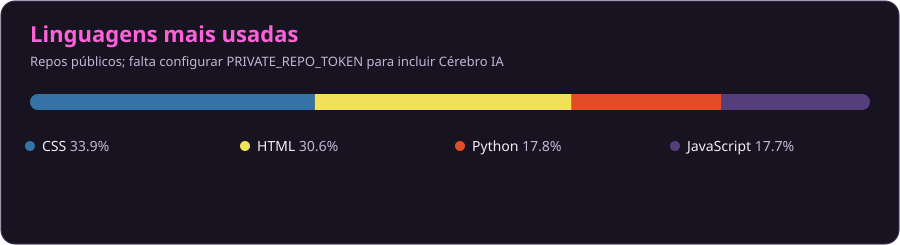

<div align="center">



<br/>


</div>

```text
$ whoami
> Christian Fulco — CEO @ Anjo Digital (Curitiba, BR)

$ cat about.txt
> Agência de marketing digital e desenvolvimento web, fundada há 3 anos.
> Sites de alta performance + Google Ads + Analytics + SEO local.
> Cursando Inteligência Artificial e Machine Learning.
> Construindo produtos próprios: Anjo 360 Tour e Cérebro IA.
```

## `> experiência`

| Frente | O que eu entrego |
| --- | --- |
| **Web** | Sites institucionais, landing pages e plataformas (HTML, CSS, JS, TypeScript, React, Next.js, Vite) |
| **Tráfego pago** | Google Ads (Rede de Pesquisa), métricas e otimização de conversão |
| **Mensuração** | Google Analytics, GTM, eventos e dashboards |
| **Presença local** | 56 Perfis de Empresa no Google sob gestão: SEO local, avaliações, atualizações |
| **IA & automação** | Python e PowerShell, fluxos com IA para pesquisa, conteúdo e relatórios |

Atendo clientes de varejo, saúde, serviços automotivos, alimentação, beleza e indústria. Estudos de caso sob demanda.

## `> projetos`

| Projeto | Descrição | Stack |
| --- | --- | --- |
| **Anjo 360 Tour** | Editor de tours virtuais 360° com mapa, hotspots e publicação no Google Street View | Python, FastAPI, SQLite, Marzipano, Google Maps/Places |
| **Cérebro IA** | Orquestração local de modelos de IA com notas do Obsidian | Python, PowerShell, Ollama, Gemini |
| **Sites de clientes** | Projetos entregues na Anjo Digital (código privado, demonstração sob pedido) | HTML, CSS, JS, React, Next.js |

Repositórios de clientes ficam privados por contrato.

## `> certificações`

Todas emitidas pelo Google em outubro de 2026 (validade de 1 ano):

- Anúncios de alta performance com tecnologia de IA
- Google Analytics
- Otimização de conversão
- Rede de Pesquisa do Google Ads
- Métricas do Google Ads
- Aumente as vendas off-line
- Em andamento: Google Product Expert

## `> stack`

<p>
  
  
  
  
  
  
  
  
  
</p>

## `> stats`

| Top Languages | GitHub Stats |
| --- | --- |
|  |  |

## `> contato`

<div>
  <a href="https://www.linkedin.com/in/christianfulcoanjodigital/" target="_blank"></a>
  <a href="https://api.whatsapp.com/send/?phone=%2B5535991611333&text&app_absent=0" target="_blank"></a>
  <a href="mailto:fulco91@hotmail.com"></a>
  <a href="https://www.instagram.com/christianpfulco/" target="_blank"></a>
</div>

<br/>

<div align="center"><sub>Wake up, Neo... the pipeline has you.</sub></div>
